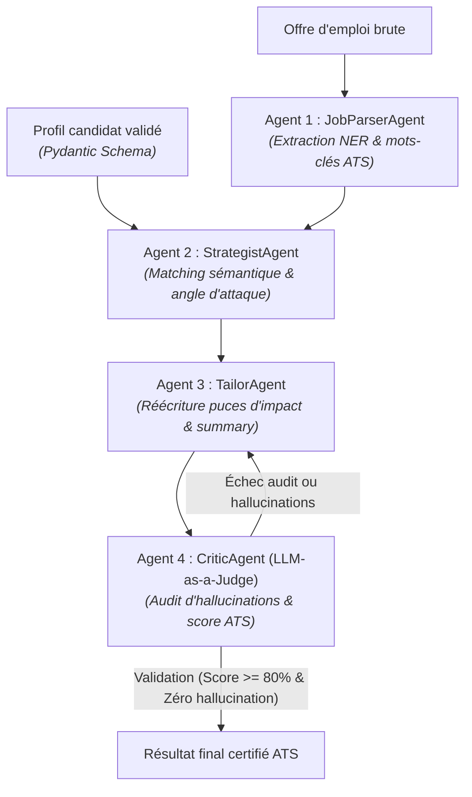

# 🚀 ResumeSquad AI — Multi-Agent ATS Optimization & Career Copilot

Plateforme d'ingénierie logicielle & IA multi-agents dédiée à l'analyse sémantique d'offres d'emploi, à l'adaptation de profils techniques et à la maximisation du score ATS sans hallucination.

---

## 🏗️ Architecture Multi-Agents (Orchestrateur & Workers)

Contrairement aux invites monolithiques sujettes aux hallucinations et à la dégradation d'attention (*Lost in the Middle*), ce système déploie une **escouade de 4 agents asynchrones et spécialisés** coordonnés par un orchestrateur central intégrant une boucle de rétroaction (*Self-Refine*) :



---

## 🤖 Rôle des 4 Agents

1. **`JobParserAgent` :** Analyse syntaxique et sémantique de l'offre d'emploi. Extrait les *hard skills*, *soft skills*, missions clés et dresse la liste prioritaire des mots-clés ATS.
2. **`StrategistAgent` :** Compare le profil réel du candidat avec l'offre. Calcule le score d'affinité, définit l'angle d'attaque éditorial et priorise les projets les plus pertinents.
3. **`TailorAgent` :** Réécrit les puces d'expérience selon la méthodologie Google XYZ (*Accompli X mesuré par Y en faisant Z*) tout en respectant une règle stricte d'anti-hallucination.
4. **`CriticAgent` (LLM-as-a-Judge) :** Auditeur impartial simulant les algorithmes de filtrage ATS et l'œil d'un Lead Dev. Il traque la moindre invention et attribue un score de conformité.

---

## 🔒 Contrats de données stricts (Pydantic v2)

Tous les échanges inter-agents sont garantis au niveau de l'inférence par le **Constrained Decoding** via les schémas Pydantic (`backend/app/models/schemas.py`). Zéro risque de parse JSON invalide ou de champs manquants.

---

## 🚀 Démarrage Rapide

### 1. Installation des dépendances
```bash
cd backend
pip install -r requirements.txt
```

### 2. Configuration
Crée ton fichier `backend/.env` à partir de `.env.example` et ajoute ta clé gratuite Google AI Studio :
```env
GEMINI_API_KEY=AIzaSy...
GEMINI_MODEL=gemini-2.5-flash
```

### 3. Exécution locale (Test autonome)
Pour tester le pipeline complet avec ton profil sans lancer de serveur :
```bash
python backend/run_local.py
```

### 4. Lancement de l'API FastAPI
```bash
cd backend
uvicorn app.main:app --reload --port 8000
```
* Swagger UI accessible sur : `http://localhost:8000/docs`
