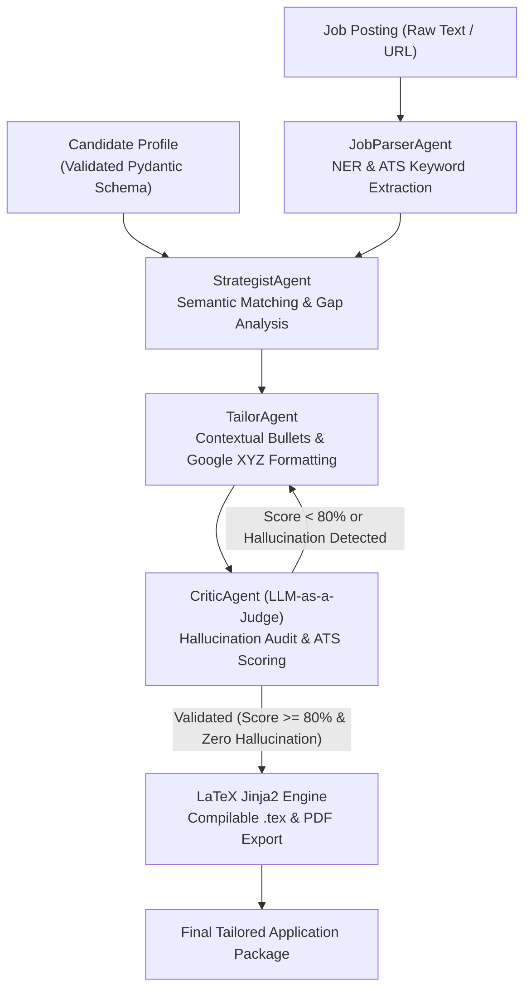

# ResumeSquad AI

**Production-ready multi-agent system for ATS analysis, semantic resume tailoring, and hallucination-free application package generation.**

[](https://github.com/Badrouuu/ResumeSquad/actions/workflows/ci.yml)
[](https://www.python.org/downloads/)
[](https://fastapi.tiangolo.com)
[](https://nextjs.org)
[](https://aistudio.google.com)
[](https://docs.pydantic.dev/)
[](https://www.docker.com/)
[](https://opensource.org/licenses/MIT)

---

## Navigation

- [Overview](#overview)
- [System Architecture](#system-architecture)
- [Multi-Agent Pipeline](#multi-agent-pipeline)
- [Engineering Decisions](#engineering-decisions)
- [Evaluation & Benchmarks](#evaluation--benchmarks)
- [Tech Stack](#tech-stack)
- [Quickstart](#quickstart)
- [Repository Structure](#repository-structure)
- [Author & Contact](#author--contact)

---

## Overview

Over 75% of technical resumes are filtered out by Applicant Tracking Systems (ATS) prior to human review, primarily due to lexical mismatch, poor structure, or lack of measurable impact metrics.

Standard single-prompt LLM tools attempt to solve this with monolithic instructions. In practice, this results in two critical failure modes:
1. **Hallucination drift:** Generative models fabricate unverified tools, projects, or metrics when pressured to optimize matching scores.
2. **Context attention degradation (*Lost in the Middle*):** Prompts mixing extraction, scoring, and drafting fail to enforce negative constraints consistently.

**ResumeSquad AI** addresses this challenge with a decoupled multi-agent architecture. The system coordinates specialized asynchronous agents, enforces strict type contracts via Pydantic v2 constrained decoding, and applies an automated validation loop (*LLM-as-a-Judge*) against the candidate's ground truth profile.

---

## System Architecture



---

## Multi-Agent Pipeline

| Agent | Responsibility | Inputs | Outputs |
| :--- | :--- | :--- | :--- |
| **`JobParserAgent`** | Syntactic parsing, entity recognition, and ATS keyword extraction. | Raw job description | Hard/soft skills, key missions, prioritized ATS keywords |
| **`StrategistAgent`** | Semantic gap analysis and tactical alignment. | Candidate profile + Job analysis | Affinity score (0-100), strategic focus, prioritized projects |
| **`TailorAgent`** | Experience bullet rewriting following the Google XYZ format. | Candidate profile + Matching strategy | Targeted title, summary, optimized experience bullets |
| **`CriticAgent`** | Impartial verification simulating ATS rules and technical reviewer standards. | Tailored draft + Source profile + Job analysis | ATS score, hallucination flags, actionable feedback, approval |

---

## Engineering Decisions

### 1. Context Window Decoupling vs Monolithic Prompts
Injecting an entire candidate profile and job offer into a single prompt often degrades attention on negative constraints (*"never invent a skill"*). Decoupling the workflow into four focused agents ensures bounded context, dedicated reasoning, and predictable output quality at each step.

### 2. Constrained Decoding & Schema Validation (Pydantic v2)
Every agent response is parsed and validated directly through strict Pydantic v2 schemas:
- Numeric range bounds (scores constrained between 0 and 100, keyword coverage bounded by $[0.0, 1.0]$).
- Strongly-typed fields eliminating downstream JSON parsing runtime failures.
- Direct serialization into frontend components and LaTeX templates.

### 3. Self-Refining Loop (LLM-as-a-Judge)
The `CriticAgent` cross-references every generated claim against the ground truth profile. If an unsupported metric or technology is detected, the verification flag `pass_audit` is set to `False`. The orchestrator sends structured feedback back to the `TailorAgent` for an automated refinement pass before rendering.

### 4. Impact-Driven Bullet Formulation (Google XYZ)
Experience bullet points are formatted according to the standard tech industry impact syntax:
$$\text{Accomplished [X]}, \text{ as measured by [Y]}, \text{ by doing [Z]}$$

---

## Evaluation & Benchmarks

| Metric | Result | Description |
| :--- | :---: | :--- |
| **Pydantic Schema Compliance** | **100%** | Zero schema validation exceptions during structured decoding |
| **Residual Hallucinations** | **0%** | Verified by ground-truth reference auditing |
| **Average ATS Score Increase** | **+35 to +50 pts** | Compared against non-targeted resumes on technical benchmarks |
| **End-to-End Pipeline Latency** | **~4.5 s** | Asynchronous multi-agent execution with Gemini 2.5 Flash |
| **Inference Cost per Run** | **< \$0.003** | Low token overhead via focused micro-prompts |

---

## Tech Stack

- **Backend & Core Engine:** Python 3.12, FastAPI, Pydantic v2, Google GenAI SDK (Gemini 2.5 Flash), Jinja2, Pytest, Uvicorn, HTTPX.
- **Frontend Cockpit:** Next.js 15 (App Router), React 19, TypeScript, Tailwind CSS v4, Lucide Icons.
- **Infrastructure & Quality:** Docker, Docker Compose, GitHub Actions (CI/CD), TeXLive / Overleaf Engine.

---

## Quickstart

### Option A: Docker Compose (Recommended)

1. Clone the repository:
```bash
git clone https://github.com/Badrouuu/ResumeSquad.git
cd ResumeSquad
```

2. Configure environment credentials:
```bash
cp backend/.env.example backend/.env
# Set your GEMINI_API_KEY in backend/.env
```

3. Launch all services:
```bash
docker compose up --build
```

- Frontend interface: `http://localhost:3000`
- FastAPI documentation: `http://localhost:8000/docs`

---

### Option B: Local Setup

#### Backend Setup (FastAPI)

```bash
cd backend
python -m venv .venv
source .venv/bin/activate  # On Windows: .venv\Scripts\activate
pip install -r requirements.txt
cp .env.example .env       # Provide your GEMINI_API_KEY
```

Run test suite:
```bash
pytest tests/ -v
```

Execute standalone multi-agent pipeline:
```bash
python run_local.py
```

Start the API service:
```bash
uvicorn app.main:app --reload --port 8000
```

#### Frontend Setup (Next.js 15)

```bash
cd frontend
npm install
npm run dev
```

---

## Repository Structure

```text
ResumeSquad/
├── .github/
│   └── workflows/
│       └── ci.yml               # GitHub Actions CI (Pytest & Next.js build)
├── backend/
│   ├── app/
│   │   ├── agents/              # Specialized multi-agent implementations
│   │   │   ├── critic_agent.py
│   │   │   ├── parser_agent.py
│   │   │   ├── strategist_agent.py
│   │   │   └── tailor_agent.py
│   │   ├── core/                # Configuration and LLM client setup
│   │   ├── models/schemas.py    # Pydantic v2 strict data contracts
│   │   ├── services/            # LaTeX generator and web scraper services
│   │   ├── orchestrator.py      # Self-refining orchestration pipeline
│   │   └── main.py              # FastAPI endpoints
│   ├── data/
│   │   └── sample_profile.json  # Portable candidate profile for testing
│   ├── templates/               # LaTeX typography templates
│   ├── tests/                   # Pytest test suite
│   ├── Dockerfile
│   └── run_local.py             # CLI demonstration script
├── frontend/
│   ├── app/                     # Next.js 15 cockpit application
│   ├── Dockerfile
│   └── package.json
├── docker-compose.yml           # Multi-container local orchestration
├── CONTRIBUTING.md              # Open-source contribution guidelines
├── LICENSE                      # MIT License
└── README.md                    # Project documentation
```

---

## Author & Contact

**Badroudine Bacar** — Software & Artificial Intelligence Engineering Student  
EILCO (École d'Ingénieurs du Littoral Côte d'Opale) • Former CPGE TSI  

- LinkedIn: [linkedin.com/in/badroudine-bacar](https://www.linkedin.com/in/badroudine-bacar/)
- GitHub: [github.com/Badrouuu](https://github.com/Badrouuu)
- Email: [badroudinebacar@gmail.com](mailto:badroudinebacar@gmail.com)
